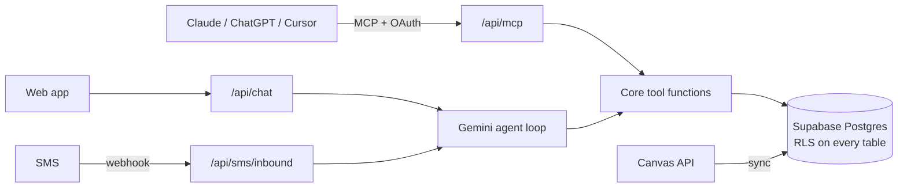

# Pluto

Pluto is an AI study assistant, built at HackUMass. It reads a student's Canvas courses, lecture PDFs, assignments and grades, and answers questions about them from Claude, ChatGPT or Cursor (through MCP), from the web app, or by text message. Every answer links to the exact PDF page it came from.

**Just want to check it out?** Open **[pluto-sepia.vercel.app](https://pluto-sepia.vercel.app)** and click **Try the demo**. It signs you in to a shared demo student with sample courses, notes and deadlines. No sign-up needed.

## What it does

- **Canvas sync:** courses, weighted grade groups, assignments (with instructions and attachments) and lecture PDFs.
- **Notes with page-level citations:** every PDF page is searchable, and every answer links to `/notes/<fileId>?page=<n>`.
- **MCP server:** Claude, ChatGPT and Cursor connect over OAuth and get read-only tools, a `save_study_guide` tool, and `study_guide`, `cram_plan` and `quiz_me` prompts.
- **Web chat:** streamed answers with source chips and clarifying questions. Answers built from notes are saved to the Notes page.
- **Grades and deadlines:** the running weighted grade per course, and the next 30 days of work with moved due dates flagged.
- **SMS:** text a question and get an answer with a one-time link to the cited page. Pluto also texts about crunch weeks and changed deadlines.
- **Calendar feed:** a private ICS link per student.

Try this in Claude once Pluto is connected: *"Build me a study guide from my History 105 notes from the past 2 weeks, use Pluto."* Claude reads the notes, writes the guide with a page link behind every fact, and saves it to the Notes page.

## How it fits together



The MCP server, the web chat, SMS and the web pages all call the same tool functions in `packages/core`, against the same database.

```
apps/web/          Next.js app: pages, API routes, MCP endpoint
packages/core/     Contract (zod), tool functions, PDF/Word ingest, magic links, SMS, ICS
packages/agent/    Gemini agent loop, plus a deterministic mock
packages/canvas/   Canvas client, sync, file ingest, fixtures
packages/mcp/      MCP tools, prompts and auth
supabase/          Migrations, RLS, seed
scripts/           Env setup, seeding, smoke and e2e tests
seed/              Synthetic lecture PDFs
docs/plan.md       Contract, data model and decision log
```

**Stack:** Next.js, Tailwind and shadcn/ui, Supabase (Auth, Postgres full-text search, Storage), the TypeScript MCP SDK, Google Gemini, Sendblue, zod, Vitest and GitHub Actions.

## Run it locally

You need Node 24+ and Docker Desktop. No API keys are needed: Gemini, SMS and Canvas all run as mocks by default.

```bash
npm ci
npx supabase start     # local Postgres, Auth and Storage, with migrations and seed
npm run env:local      # writes apps/web/.env.local
npm run seed           # uploads and ingests the synthetic PDFs
npm run dev            # http://localhost:3000
```

Sign in as `demo@pluto.test` with password `pluto-demo-local-1`. See `.env.example` for every setting, including how to switch to real Gemini, Sendblue and Canvas.

| Command | What it does |
| --- | --- |
| `npm run typecheck` / `npm run lint` | Checks every workspace |
| `npm test` | Unit tests, plus database tests against local Supabase |
| `npm run smoke` | End-to-end check of the core tools |
| `npm run e2e:chat` | Browser tests for chat, notes, SMS and RLS |

## Security

- Row-level security on every table, and every query also filters by `student_id`. Tests check that one student can't read another's data.
- Students can't write server-owned columns such as phone, storage paths or the Canvas token.
- Canvas tokens are encrypted with AES-256-GCM. Magic-link and phone-link codes are stored only as hashes.
- The service-role key is used only in server routes that first verify a secret, signature or token.
- The agent treats all tool output as untrusted data, and only cites pages that tools returned.

## How it was built

Pluto was built during the hackathon by a team of AI coding agents (Claude and Cursor). A director agent planned the work and owned the contract, coders each worked in their own git worktree, and fresh reviewers checked every security-sensitive PR before it merged. The briefs, plans and reports are in `orchestrations/`.
